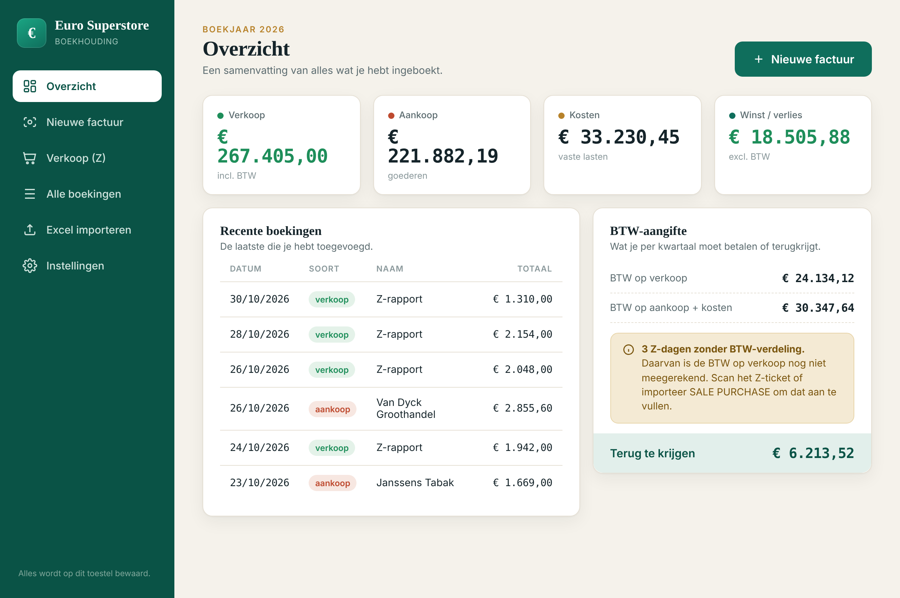
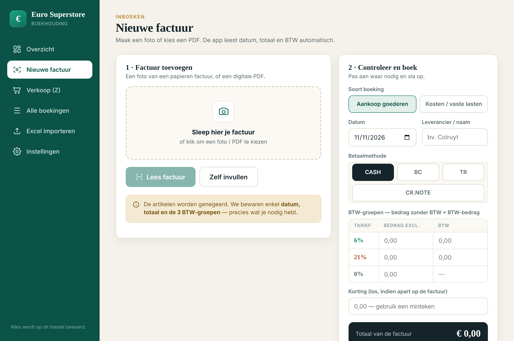
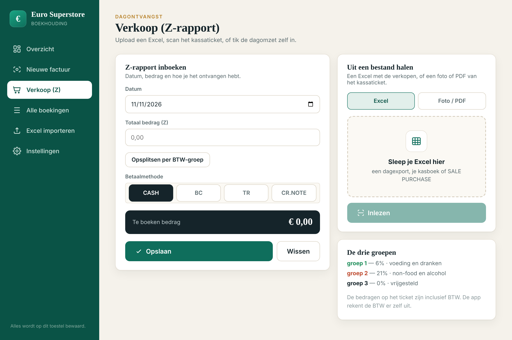
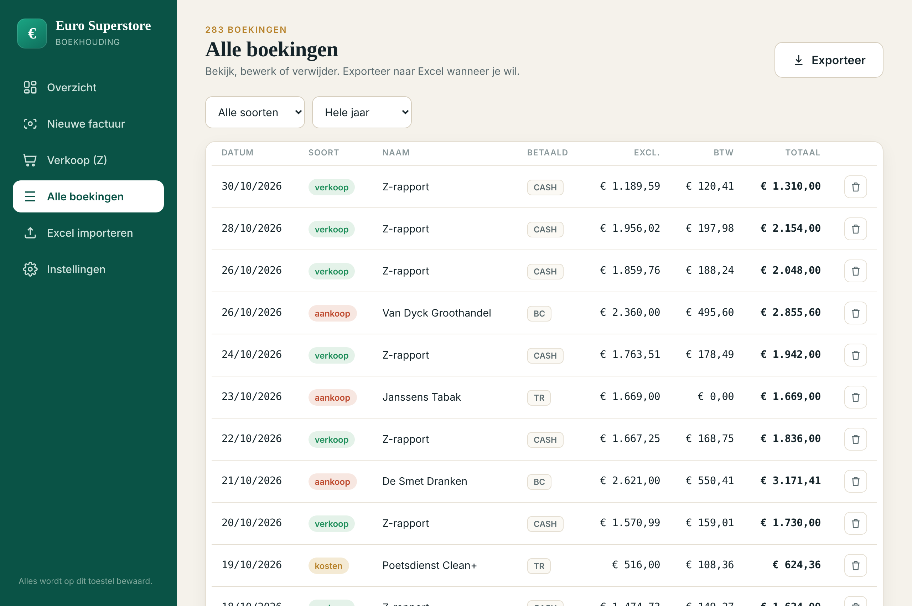
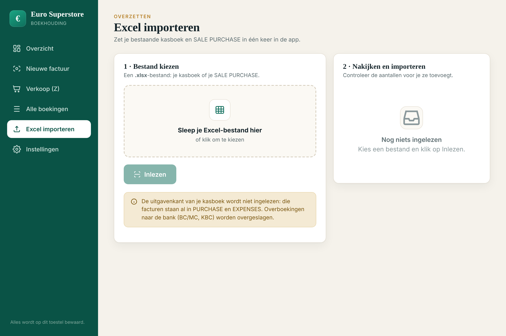

# Euro Superstore Boekhouding

Een desktop-boekhoudapp (Electron, Windows 10/11) die ik gebouwd heb voor de
kleine superstore van mijn vader, ter vervanging van een foutgevoelige
Excel-workflow met twee losse werkmappen.

De winkel hield alles bij in `Kasboek<jaar>.xlsx` (dagontvangsten) en
`SALE PURCHASE <jaar>.xlsx` (verkoop, aankopen en kosten). Overtypen,
BTW-groepen handmatig verdelen en per kwartaal alles weer optellen — dat is
wat deze app overneemt.



> De cijfers op alle screenshots zijn verzonnen demodata. Er staan geen
> echte boekingen, leveranciers of bedrijfsgegevens in deze repo.

---

## Wat het doet

**Facturen inlezen uit een foto of PDF.** Een aankoopfactuur gaat erin als
foto of PDF; datum, leverancier, totaal en de BTW-verdeling komen er
gestructureerd uit. De artikelen worden bewust genegeerd — voor de boekhouding
tellen alleen datum, totaal en de drie BTW-groepen.

**Z-rapporten verwerken.** De dagomzet kan op drie manieren binnen: een
Excel-export uit de kassa, een foto van het kassaticket, of handmatig.

**De bestaande Excel importeren.** Beide werkmappen worden herkend aan hun
tabbladen en ingelezen met behoud van de originele bedragen. De BTW wordt
overgenomen zoals ze in het bestand staat, niet herberekend, zodat elk
factuurtotaal exact gelijk blijft.

**BTW-aangifte per kwartaal.** BTW op verkoop min BTW op aankoop, met de
basisbedragen per tarief.

**Export naar XLSX en CSV**, met verkoop en aankopen op aparte werkbladen.

| | |
|---|---|
|  |  |
|  |  |

---

## Het interessante deel: de datamodellering

Het grootste deel van het werk zat niet in de UI, maar in het uitzoeken hoe de
bestaande papieren en Excel-processen zich laten vertalen naar één datamodel.
Een paar beslissingen die uit het analyseren van de echte facturen kwamen:

**De BTW-groepen volgen het bestand, niet de theorie.** Groep 1 = 6%,
groep 2 = 21%, groep 3 = 0%, afgeleid uit de kolomkoppen van de bestaande
werkmap. Departement 4 bestaat in de kassa maar wordt nergens gebruikt en
wordt genegeerd.

**Het factuurtotaal is heilig.** Bedragen incl. BTW omrekenen naar excl. BTW
geeft afrondingsverschillen van een cent. In plaats van te herberekenen wordt
de BTW overgenomen zoals ze op de factuur staat en komt een eventueel verschil
tussen de groepen en het totaal in het veld `korting` terecht — want dat is in
de praktijk ook wat het is.

**Bankoverschrijvingen zijn geen aankoop.** Regels met `BC/MC` of `KBC` in het
kasboek zijn geld dat naar de bank gaat, geen uitgave. Die worden
overgeslagen, anders staan ze dubbel: één keer als overschrijving en één keer
als de factuur die ermee betaald werd.

**Duplicaatdetectie kijkt verder dan datum + bedrag.** De eerste versie
markeerde creditnota's als duplicaat van de factuur waar ze bij hoorden —
zelfde datum, zelfde bedrag. De vergelijking kijkt nu ook naar de
leveranciersnaam en de betaalwijze.

**Datumdetectie over JS-contexten heen.** `instanceof Date` faalt stilzwijgend
wanneer de xlsx-bibliotheek in een andere JavaScript-context draait dan de
code die de waarde controleert: echte Excel-datums verdwenen zonder foutmelding.
`Object.prototype.toString.call(v) === "[object Date]"` werkt wel over contexten
heen. Zie [`renderer/import-core.js`](renderer/import-core.js#L286).

De import is gevalideerd tegen de volledige historiek van de winkel en de
totalen kwamen exact overeen met de bestaande werkmap.

---

## Techniek

| | |
|---|---|
| Runtime | Electron 31, Node.js |
| Frontend | Vanilla JavaScript, geen framework |
| Excel | SheetJS (lokaal gebundeld, werkt offline) |
| Opslag | Eén JSON-bestand in de Windows-app-map |
| Build | electron-builder → NSIS-installer + portable `.exe` |
| Factuurherkenning | Anthropic API (vision), sleutel door de gebruiker zelf in te stellen |

**Architectuur.** De renderer draait met `contextIsolation: true` en
`nodeIntegration: false`; alle toegang tot het bestandssysteem en het netwerk
loopt via een smalle `contextBridge`-API in
[`preload.js`](preload.js) met zeven methodes. De API-sleutel staat alleen in
het hoofdproces en bereikt de renderer nooit.

**Offline.** Inboeken, importeren, het overzicht en de export werken zonder
internet. Alleen het automatisch lezen van een factuurfoto heeft een
verbinding nodig.

---

## Zelf draaien

```bash
git clone https://github.com/<gebruiker>/euro-superstore-boekhouding.git
cd euro-superstore-boekhouding
npm install
npm start
```

Een Windows-installer bouwen: `npm run dist`, of op Windows dubbelklikken op
`build.bat`. Het resultaat staat in `dist/`.

De uitgebreide handleiding voor de eindgebruiker staat in
[`HANDLEIDING.md`](HANDLEIDING.md).

---

## Over het bouwproces

Ik heb AI-tools gebruikt als hulpmiddel bij het schrijven en debuggen van de
code. De architectuur, het datamodel en de eindverantwoordelijkheid voor de
werking liggen bij mij — net als het analyseren van de echte facturen en
Excel-bestanden waar het hele model uit voortkomt.

## Licentie

MIT — zie [LICENSE](LICENSE).
